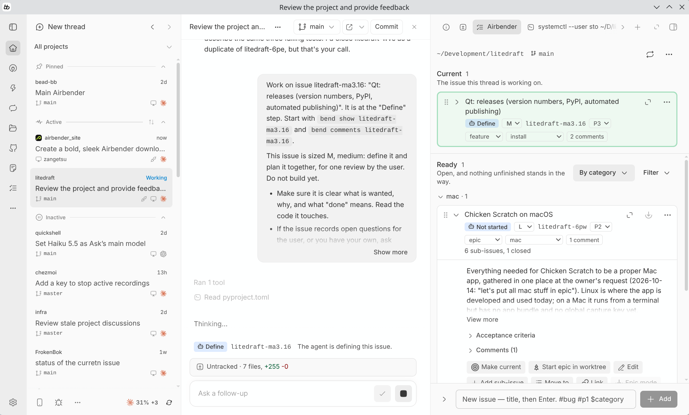

# Airbender

**Never get lost in vibe coding.**

Airbender is a plugin for [BB](https://getbb.app), the coding-agent app. It
keeps your project's issues in a tab beside every agent conversation, so each
agent knows what it is on and you always know what comes next. Issues live in
your tracker, [beads](https://github.com/gastownhall/beads) inside the
repository or GitHub issues, never in the chat. It works with Claude Code and
Codex inside BB.

[Website](https://mturilin.github.io/airbender/) ·
[Install](#install) ·
[How it works](#how-it-works) ·
[bend, the command for agents](#bend-the-command-for-agents) ·
[Development](#development)



## The problem

Your agent got fast. Your process is still a terminal tab and a good memory.

- **The work list lives somewhere else.** To see what is next, or to write a
  thought down, you leave the conversation. So you stop writing things down.
- **The agent decides when it is done.** It builds before you agreed on what
  to build, and commits before you looked. You find out in the diff.
- **The reasons die with the chat.** What you asked for, what was tried and
  why it was decided scrolls away. Next week nobody knows, including the
  agent.

## What you get

- **An issue in one line, without leaving the conversation.** The field at
  the bottom of the tab is always there. `Fix login redirect #bug #p1 $ux`
  sets the type, the priority and the category as you type.
- **A fixed path for every issue, and at each step it waits for exactly one
  of you.** The agent defines, plans, builds and reviews its own work. You
  approve the definition, the plan and the result. Nothing closes until the
  work is in git.
- **Only the steps an issue needs.** A background agent sizes each issue S,
  M or L. A typo fix reaches you once, at the end. A risky change stops at
  every turn.
- **The decision where you are reading.** A line above the message box names
  the issue, its step and what is needed from you; the step's buttons sit
  inside the box. Or just reply: a reply that asks for changes sends the
  issue back, a question leaves it where it is.
- **Three issues, three work trees, one clean main.** Start an issue in a
  work tree and a new conversation opens for it on a branch of its own. When
  you accept, the agent lands it on main and the branch, the work tree and
  the conversation are cleaned up.
- **Epics on Autopilot.** Nest issues under one, give the epic a branch, and
  Autopilot starts its ready issues one after another. Every review is still
  yours.
- **The issue is the record.** Intent in your words, the plan, every decision
  with its reason, what was tried: written onto the issue by the agent as it
  works, so the next session, and the next agent, can pick it up.
- **Two trackers, switchable.** beads for many agents writing at once, GitHub
  issues for projects that move at human pace. Start on either and switch
  from the tab's menu; your issues come with you.

## Install

You need BB 0.44 or later on the machine that has the repository, and Go
1.24 or later, which builds the `bend` program. The tab offers everything
else when it is missing: beads, the build of `bend`, the rules for your
agent.

1. **Install the plugin** where BB is installed:

   ```sh
   bb plugin install https://github.com/mturilin/airbender
   ```

2. **Open the tab.** In any conversation: right-hand panel, new tab,
   **Airbender**.

3. **Pick a tracker and say yes to setup.** beads or GitHub issues. The tab
   then offers whatever the folder is missing, one step at a time, each in
   a terminal you can watch and each with a Skip. The same steps run from a
   terminal with `bend setup`.

To build it yourself instead:

```sh
git clone https://github.com/mturilin/airbender
cd airbender
npm install --include=dev
bb plugin build
bb plugin install .
```

## How it works

Airbender is a view of your tracker, not a second tracker. The tab shows the
issues of the folder the conversation works in, grouped by what you can do
about them: in progress, ready, blocked, other, and closed. It follows
changes made anywhere, by an agent or by you in a terminal, by itself.

### The workflow

On the **Standard** workflow every issue goes through the same steps to be
closed. At each step it waits for the agent or for you, and every open issue
shows its step and one button for it.

| Step | Whose move | What happens |
|---|---|---|
| Not started | you | Press play. The agent sizes the issue first. |
| Define | agent | Writes up what is wanted, why, and what "done" means. |
| Review definition | you | Approve, or send it back with a reason. |
| Plan | agent | Works out how, and writes the plan onto the issue. |
| Review plan | you | Approve, or send it back. |
| Implement | agent | Does the work. |
| Agent review | agent | Reviews its own work against the issue. |
| Human review | you | Accept, or send it back. |
| Apply | you | Choose **Commit** or **Commit & merge**. On main, Accept goes straight to the commit. |
| Commit | agent | Commits the work, one commit per issue, named after it. The issue closes. |

An issue takes only the steps its size needs: **S** is done in one go and
reaches you once, at the end; **M** has one review at the front, of the
definition and the plan together; **L** takes every step. You can set or
change the size until the work reaches you.

The **Simple** workflow has no steps at all: each issue has Make current,
Release and Close, and you direct the agent yourself. The choice is per
repository, from the tab's menu, and switching back puts every issue at the
step where it was.

### Around the message box

While a conversation has a current issue, one line above the message box
shows the issue, its step and what is needed now, and the step's moves are
buttons inside the box: approve, or send back with the reason you just
typed. A grey "Agree & continue" button is always there. Hover the line for
the whole issue.

### Branches, work trees and epics

- **Start in branch** does the issue's work on a branch of its own in the
  same conversation, and "Commit & merge" lands it, pushes main and deletes
  the branch.
- **Start in worktree** opens a new conversation for the issue in a work
  tree BB makes, so several issues can be worked at once. At the end the
  agent brings main into its branch, lands it, and Airbender archives the
  conversation and removes the work tree and the branch.
- **Epics** are issues with sub-issues, to any depth. Drag an issue onto
  another to nest it. **Start epic in branch** or **in worktree** gives the
  whole epic one branch and zooms the tab in on it. **Autopilot** then
  starts its ready issues one after another, most urgent first, and stops
  and says why if one gets stuck. When the last one closes: "Close & merge".

### Two trackers

| | beads | GitHub issues |
|---|---|---|
| Where issues live | A database inside your repository, synced to your git remote | On GitHub, where everyone already looks |
| Speed | Instant: no network, no request limits | A local copy keeps the tab fast; new issues and step changes go through GitHub, whose request limits apply |
| Best for | Many agents at once, epics on Autopilot, work trees | Projects that move at human pace, open source backlogs, teams on GitHub |

Switch between them at any time from the tab's menu. Nothing is deleted on
either side. Coming to beads from GitHub with a backlog? "Import / export
GitHub issues" brings it in, comments and all, and sends yours back.

### What the agent gets

- **`bend`**, one command for issues whatever the tracker (below). Agents
  never need `bd` or `gh issue`.
- **Two tools in every conversation**: one to say which issue it is on, one
  to move an issue's step. Where they do not apply, they refuse in plain
  words.
- **The rules**, written into the repository's `AGENTS.md` by setup: record
  everything on the issue, take it one step at a time, never close an issue
  yourself, commit only after the owner accepted. Standing facts about the
  project live in `FACTS.md`, kept by `bend remember`.

### What it is not

- **Not a second issue tracker.** Issues stay where they are; the tab shows
  and changes them there.
- **Not an auto-closer.** No issue closes without you.
- **Not a git tool.** The plugin never commits by itself; it asks the agent
  to, in the conversation, where you can see it.
- **Not a cloud service.** There is no Airbender server. Your issues are in
  your repository or on your GitHub, nowhere else.

## bend, the command for agents

`bend` reads and changes a repository's issues from a terminal, the same way
whatever tracker holds them. The tab uses the very same program, so the two
cannot drift apart. It is one Go binary with no dependencies.

```sh
bend status                       # which tracker is here and what it can hold
bend ready                        # issues that can be worked on now
bend show app-1x2                 # one issue in full
bend create "Remember the last shipping address" --type feature --priority 2
bend write app-1x2 plan "..."     # write the plan onto the issue
bend decide app-1x2 "X, because Y"
bend setup                        # what this repository still needs
```

Build it with `cd bend && go build -o ~/.local/bin/bend ./cmd/bend`, or let
the tab's setup do it. [bend/README.md](bend/README.md) has the whole
story: setting a repository up from a terminal, the local copy, syncing,
the JSON output for programs, and the tests.

## Settings

In BB under Tools, then Airbender.

- **bd command**: name or path of the beads tool, only if BB cannot find it.
- **Size issues in the background**, and the **provider** and **model** the
  sizing agent runs on (by default Claude Code and a small Claude model).
- **GitHub token**: optional, for "Import / export GitHub issues"; by default
  the `gh` command's sign-in is used and nothing is stored.

## Limits of this version

- The tab edits an issue's title, description, type, priority, category,
  parent and links. Design, acceptance criteria, notes and comments are
  written by agents through `bend`, and issues are not deleted from the tab.
- The repository must be on the machine BB runs on. A conversation whose
  folder is on another machine gets an explanation instead of a list.

## Development

```sh
npm install --include=dev
bb plugin build          # compile into dist/
bb plugin install .      # register this folder with BB
bb plugin dev            # rebuild and reload on every save
npx tsc --noEmit         # typecheck
npm test                 # the plugin's tests (node's own runner)
cd bend && go test ./... # bend's tests
```

- `server.ts`, `server/`: the backend. Runs `bend` for every read and change
  of an issue, moves issues through the workflow, starts agents, keeps each
  conversation's current issue, and watches for changes made elsewhere.
- `app.tsx`, `app/`: the tab, the controls around the message box, the
  issue card and the setup card. `components/ui/` is vendored UI source
  owned by this plugin.
- `shared/`: what both halves agree on, above all the workflow
  (`standard-workflow.ts`: the steps, the button labels and the wording for
  agents; nothing else names a step).
- `bend/`: the Go program. One adapter per tracker, a local copy above
  them, setup, the rules for agents, and the sync helper.
- `specs/PRD.md`: the product spec. It describes what is built, from the
  owner's point of view, and is updated in the same commit as every change.
- `site/`: the website, published with GitHub Pages.

The plugin's own issues are kept in beads, in this repository. With `bend`
built, `bend ready` lists what is open.

## Licence

No licence has been chosen yet, so for now the code is published to read
and not yet to reuse. A licence file will follow.
